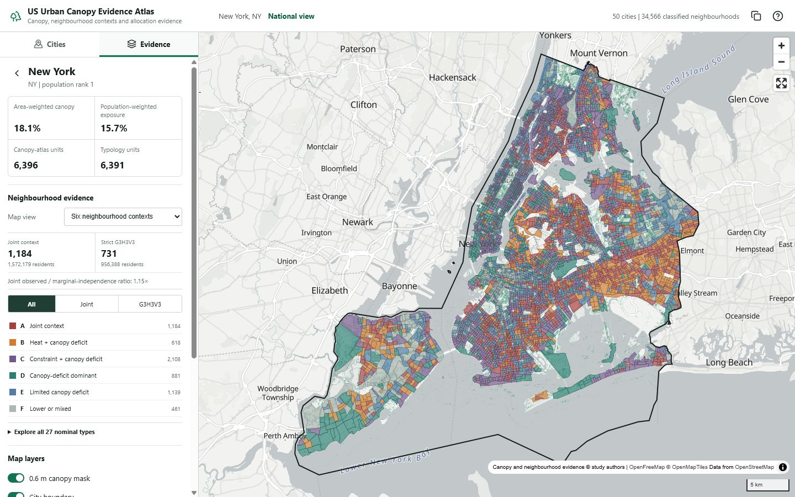

# US Urban Canopy Evidence Atlas

**Live deployment:** [http://8.217.164.241/atlas/](http://8.217.164.241/atlas/)

This directory contains the interactive companion map for the 50-city canopy
atlas. The application is deliberately city-first: users select a city, retain
the native 0.6 m canopy mask as a base evidence layer, and switch among the
prespecified neighbourhood typology, its three component dimensions and equal-area
allocation diagnostics.

The viewer does not describe individual trees, cast shade, personal heat
exposure or plantable land. It displays visible woody crown mapped by the study
model. For legibility at inspection scales, the tile service removes
8-connected canopy components containing only 1-5 native pixels. This is a
display-only operation: the archived masks and all manuscript statistics remain
unchanged.



## Architecture

- `src/`: React and MapLibre user interface.
- `server/`: whitelisted FastAPI tile and point-query service.
- `scripts/build_cogs.py`: resumable conversion of city masks to COGs.
- `scripts/build_catalog.py`: joins map bounds, city metrics and imagery dates.
- `scripts/audit_atlas.py`: release checks for catalogue, boundaries and COGs.
- `scripts/build_neighbourhood_layers.py`: joins the frozen 27-type analysis to
  census geometries and writes compact city GeoJSON files.
- `scripts/audit_neighbourhood_layers.py`: validates all 34,566 neighbourhoods,
  level/type/context consistency and allocation ranges.
- `config/city_registry.csv`: frozen correspondence between 50 cities and files.
- `public/catalog/`: generated JSON and GeoJSON catalogue files.

Field definitions and map-value semantics are documented in
`docs/data_dictionary.md`.

Raw masks and generated COGs are deployment assets and must not be committed to
Git. They are also outside the scope of the minimum Zenodo supporting dataset.

## Build the raster assets

The source masks are single-band `uint8` GeoTIFFs with values `0`, `255` and
nodata `254`. Convert them to tiled COGs with internal overview pyramids:

```powershell
python scripts/build_cogs.py `
  --source-root "E:\path\to\city_masks" `
  --output-root "E:\path\to\canopy_cogs" `
  --workers 2 `
  --gdal-threads 4
```

The script writes each city to a process-specific temporary file, validates the
COG before an atomic rename and merges completed records into
`cog_manifest.json`. Rerunning without `--overwrite` preserves completed cities.

Generate the public catalogue after the COGs are present:

```powershell
python scripts/build_catalog.py `
  --cog-root "E:\path\to\canopy_cogs" `
  --boundary-root "E:\path\to\city_boundaries" `
  --metrics "E:\path\to\city_metrics.csv" `
  --tract-frame "E:\path\to\result2_primary_fully_contained_tracts.csv" `
  --imagery-dates "E:\path\to\imagery_dates.csv"
```

## Build the neighbourhood evidence layers

The public evidence layer is frozen to release `GHV27-2026-08-09`. Build one
GeoJSON file per city from the classified analysis frame and public census
geometry. The script reproduces the four displayed equal-area allocation rules
from G, H and V rather than importing allocations from an older analysis:

```powershell
python scripts/build_neighbourhood_layers.py `
  --classification "E:\path\to\fully_contained_primary_GHV27.csv.gz" `
  --acs-root "E:\path\to\city_acs_folders"
```

The build fails unless all 34,566 block groups and all 50 cities are present,
the 27 nominal labels agree with G/H/V levels, the six context labels agree
with their frozen definitions and all four ranking rules preserve the same
city-specific area budget. Audit the generated web layer with:

```powershell
python scripts/audit_neighbourhood_layers.py
```

Run the release audit:

```powershell
python scripts/audit_atlas.py `
  --cog-root "E:\path\to\canopy_cogs" `
  --require-all
```

## Run locally

Install the API dependencies in a dedicated environment:

```powershell
python -m venv .venv
.\.venv\Scripts\python.exe -m pip install -r server\requirements.txt
```

Start the API:

```powershell
$env:ATLAS_COG_ROOT="E:\path\to\canopy_cogs"
$env:ATLAS_CATALOG="$PWD\public\catalog\cities.json"
.\.venv\Scripts\python.exe -m uvicorn server.app:app --host 127.0.0.1 --port 8000
```

The display filter defaults to a six-pixel minimum with 8-neighbour
connectivity. `ATLAS_MIN_CANOPY_COMPONENT_PIXELS` can change the minimum for a
diagnostic deployment, and `ATLAS_CANOPY_FILTER_MIN_ZOOM` controls the zoom from
which native-pixel filtering is applied (default 15). Publication deployments
should retain the documented defaults.

In a second terminal, install and start the web client:

```powershell
pnpm install --ignore-workspace
pnpm --ignore-workspace run dev
```

Open the URL reported by Vite. If its default port is occupied, Vite selects the next
available local URL.

For this workstation, the checked local launcher starts any missing service,
waits for both health checks and records server logs under `runtime/logs/`:

```powershell
powershell -ExecutionPolicy Bypass -File scripts\start_local_atlas.ps1
```

Use `-NoBrowser` when only the services should be started. The launcher reuses
healthy services already listening on ports 8000 and 5175 instead of starting
duplicates.

## Public release

Do not upload the COG directory to GitHub. The public deployment reads the COGs
from the configured HTTP range-enabled server, but full-resolution masks and
COGs are not distributed through GitHub or the minimum supporting dataset. The
licence-permitted neighbourhood GeoJSON layers and reference boundaries are
archived at https://doi.org/10.5281/zenodo.21976810 and remain tracked here so
the web client can be built reproducibly. Their licence scope is documented in
`../DATA_LICENSE.md`.

Set `ATLAS_COG_BASE_URL` for a production tile service. Deployment details and
the DOI-plus-viewer architecture are in `docs/deployment.md`.
